# Falésia ao vento — arte e CFD

Uma bicicleta estacionada no alto de uma falésia gramada, de frente para o mar. O **vento que move a cena é calculado** por uma simulação de dinâmica dos fluidos computacional (CFD). Grama, flores e nuvens se movem com esse campo de velocidade. Um **modo científico** mostra o mesmo escoamento como engenharia: corte vertical, mapas de cor, linhas de corrente, vetores e perfis de velocidade.

Vídeo de 22 s: [video/falesia_ao_vento.mp4](video/falesia_ao_vento.mp4)

| artístico | científico |
| --- | --- |
| 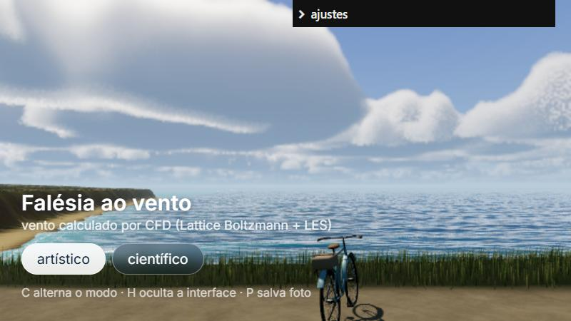 | 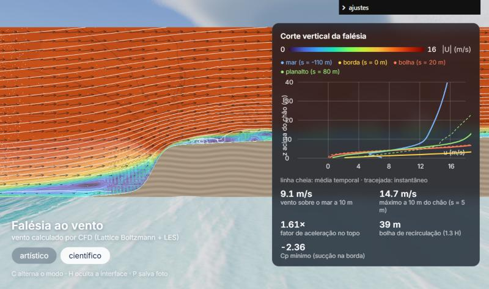 |

## Como rodar

```bash
npm install
npm run dev
```

Abra http://localhost:5174.

| Atalho | Ação |
| --- | --- |
| arrastar / roda do mouse | girar e aproximar a câmera |
| `C` ou botões | alternar modo **artístico** ↔ **científico** |
| `H` | ocultar a interface |
| `P` | salvar foto (PNG) |

O painel **ajustes** controla a escala do vento, as rajadas (campo instantâneo ou médio), a componente ao longo da costa, o sol, as nuvens e, no modo científico, a grandeza do mapa de cor (|U|, u, w, Cp, k), as linhas de corrente, os vetores e as partículas.

Parâmetros de qualidade pela URL, para PCs com GPU integrada:

| URL | efeito |
| --- | --- |
| `?grama=40000` | menos folhas de grama (padrão 90 000) |
| `?nuvens=2d` | nuvens 2D baratas em vez de volumétricas |
| `?ceu=0.35` | resolução do céu volumétrico (padrão 0,5 da tela) |

### Regerar os dados

```bash
npm run cfd          # simulação (grade de 1 m, ~12 min num i3) -> public/dados/
npm run cfd:fino     # grade de 0,5 m (~8x mais lento)
npm run figuras      # figuras de engenharia -> docs/figuras/ e resumo numérico
npm run modelos      # bicicleta no Blender -> public/models/
```

Verificação e validação (seção 7), cerca de 2 h no total num i3:

```bash
cd cfd
python verificacao_poiseuille.py                  # teste analítico (~2 min)
python verificacao_poiseuille.py --convergencia   # ordem de convergência (~5 min)
python lbm_falesia.py --dx 2 --media 3.2 --sem-exportar --quadros 1 --npz verificacao/malha_2m.npz
python lbm_falesia.py --dx 1 --media 3.2 --sem-exportar --npz verificacao/malha_1m.npz
python lbm_falesia.py --dx 0.5 --sem-exportar --quadros 1 --npz verificacao/malha_05m.npz
python verificacao_falesia.py                     # malha, estatística, massa, Eurocode
```

Requisitos do Python: `numpy`, `numba` e `matplotlib`.

### Vídeo de divulgação

```bash
npm run dev          # deixe rodando
npm run video        # 22 s, 1080 x 1350, 30 fps -> video/falesia_ao_vento.mp4
```

[video/gravar.py](video/gravar.py) abre a cena no Microsoft Edge (Playwright) em modo `?gravar`. Nesse modo o tempo avança exatamente 1/30 s por quadro e a câmera segue o roteiro de [src/gravacao.js](src/gravacao.js), então o vídeo sai liso mesmo numa GPU integrada. O MP4 é montado pelo editor de vídeo do Blender, que já traz o ffmpeg. Requer `playwright` no Python.

## Arquitetura: por que CFD offline + tempo real

| caminho | prós | contras |
| --- | --- | --- |
| (a) fluido na GPU em tempo real | interativo | grade grossa, sem unidades físicas, difícil de validar; pesado numa GPU integrada |
| (b) OpenFOAM | padrão da indústria | instalação no Windows (WSL), malha e pós-processamento custosos |
| **(c) solver próprio offline + Three.js** | **física de verdade, em unidades, validável com figuras; a cena só lê o resultado** | o vento não reage a mudanças de geometria em tempo real |

Fluxo de dados:

```
cfd/geometria.py ──perfil h(s)──┬──> cfd/lbm_falesia.py ──> public/dados/{vento.json, campo_medio.bin, rajadas.bin}
                                └──> public/dados/perfil.json                      │
                                                                                   ▼
                    src/geometria.js (mundo 3D <-> corte CFD) ──> src/vento.js (texturas 2D/3D + amostrador CPU)
                                                                     │
                     grama · flores · nuvens · modo científico (todos leem o MESMO campo)
```

---

## A física (para a apresentação)

### 1. Geometria e domínio

O escoamento é resolvido num **corte vertical 2D perpendicular à costa**. A falésia é um perfil `h(s)`, em que `s` é a distância horizontal até a borda (s > 0 terra adentro):

- face com inclinação máxima de cerca de 65°, altura **H = 30 m**
- praia de areia (declive 1:12) entre s = −52 m e o pé da falésia
- planalto subindo 2 %, com ondulação leve

Domínio: s ∈ [−250, 350] m, z ∈ [0, 240] m, grade de **600 × 240 células (Δx = 1 m)**. O topo alto mantém o bloqueio em 30/240 = 12,5 %.

A cena 3D usa **exatamente o mesmo perfil** ([src/geometria.js](src/geometria.js)). A borda no 3D é uma curva `z = zBorda(x)`, e cada ponto do mundo é convertido em `(s, z − h(s))` para consultar o CFD.

### 2. Equações

Navier–Stokes incompressível com modelo de turbulência LES:

```
∂u/∂t + (u·∇)u = −∇p/ρ + ∇·[(ν + ν_t)(∇u + ∇uᵀ)]        ∇·u = 0
ν_t = (C_s Δ)² |S̄|,   |S̄| = √(2 S̄:S̄),   C_s = 0,17      (Smagorinsky)
```

### 3. Método: Lattice Boltzmann D2Q9 ([cfd/lbm_falesia.py](cfd/lbm_falesia.py))

Em vez de discretizar Navier–Stokes diretamente, o LBM evolui as populações `f_i` de partículas que andam em 9 direções `c_i`:

```
f_i(x + c_i Δt, t + Δt) = f_i^eq + (1 − 1/τ) f_i^neq,reg
f_i^eq = w_i ρ [1 + 3 c_i·u + 9/2 (c_i·u)² − 3/2 u²]
```

A expansão de Chapman–Enskog mostra que isso recupera Navier–Stokes, com `ν = c_s² (τ − ½) Δt` e `p = c_s² ρ`.

- **Smagorinsky no LBM:** o tensor `S̄` vem localmente do momento de não-equilíbrio `Π = Σ c_i c_i (f_i − f_i^eq)`, sem diferenças finitas. O tempo de relaxação efetivo sai em forma fechada: `τ_ef = ½ (τ₀ + √(τ₀² + 18 C_s² √(2 Π:Π)/ρ))` (Hou et al., 1996).
- **Colisão regularizada** (Latt & Chopard, 2006): `f^neq` é projetado sobre `Π` antes de relaxar. Isso remove os "modos fantasmas" que, com BGK puro, geravam um ruído em xadrez no campo de pressão. O problema e a correção estão na seção 7.
- O código usa **Numba** (paralelo, cerca de 20 ms por passo num i3 de 4 threads).

### 4. Condições de contorno

| fronteira | condição |
| --- | --- |
| entrada (mar aberto) | camada-limite marinha `u(z) = 10 m/s · (z/10)^0,11` + rajadas sintéticas (5 modos senoidais de 4 a 26 s; amplitude RMS ≈ 4 % de u) |
| saída | pressão fixa (ρ = 1) com a velocidade da coluna vizinha + **camada esponja** de 80 m (viscosidade crescente) |
| topo | deslizamento livre (reflexão especular) |
| mar e terreno | **modelo de parede pela lei logarítmica** (abaixo) |

**Modelo de parede.** Com Δx = 1 m não dá para resolver a subcamada viscosa (milímetros). A primeira versão, com não-deslizamento puro, criou uma camada-limite artificialmente grossa: o vento a 10 m sobre o mar caía de 10 para 5,4 m/s. A correção impõe a tensão da lei log:

```
τ_w = ρ u*²,    u* = κ U₁ / ln(z₁/z₀),    κ = 0,41,  z₁ = Δx/2
z₀: mar 0,2 mm · areia 1 mm · face rochosa 5 cm · grama 3 cm
```

No LBM isso é um **bounce-back de parede móvel**, cuja velocidade de deslizamento `u_w = U₁ − τ_w (Δx/2) / (ρ ν_ef)` produz exatamente `τ_w`.

### 5. Unidades e números

| grandeza | valor |
| --- | --- |
| Δx | 1 m |
| Δt | 6,3 ms (Mach de rede ≈ 0,16) |
| passos | 30 260 (192 s simulados: 96 s de aquecimento + 96 s de média) |
| instantâneos exportados | 128 quadros a cada 0,152 s (laço de 19,5 s) perto da borda |
| Re físico (U·H/ν_ar) | ~2·10⁷ |
| Re de rede (viscosidade de base) | 2·10⁴; a dissipação das escalas não resolvidas fica com o Smagorinsky |

O Re físico é inalcançável com qualquer grade razoável. Mas a separação numa **quina viva** é praticamente independente de Re: o ponto de separação é fixado pela geometria. Por isso o campo adimensional `u/U_ref` vale para outras velocidades. A cena usa por padrão `U_ref = 14 m/s` (fator 1,4 sobre o simulado), o que é ajustável no painel.

### 6. Resultados

Valores da malha de 1 m (a usada na cena). A incerteza de cada um vem da seção 7.

| resultado | valor | confiança |
| --- | --- | --- |
| vento sobre o mar a 10 m | 9,3 m/s | alta (GCI 0,1 %) |
| fator de aceleração ΔS = U/U_mar − 1, a 10 m do chão | **+0,58** (malhas: 0,59 / 0,58 / 0,61) | boa (±5 %); **a 6 % do Eurocode** |
| ΔS a 20 m do chão | +0,47 (0,43 / 0,47 / 0,45) | boa (±7 %); a 1 % do Eurocode |
| ΔS a 5 m do chão | +0,98 (1,11 / 0,98 / 0,84) | **baixa:** ainda muda com a malha |
| Cp mínimo entre 2 e 15 m acima do chão (sucção na borda) | −1,73 (−2,02 / −1,73 / −1,61) | média (GCI 6,6 %, convergência monotônica) |
| bolha de recirculação (u < 0 a 1 m do chão) | 1,2 H (0 / 1,2 / 0,63 H) | **baixa:** existe nas malhas de 1 e 0,5 m, mas o tamanho não convergiu |
| energia cinética turbulenta máxima | ≈ 10 m²/s², na camada cisalhante que sai da borda | qualitativa (2D) |

Entre parênteses: malhas de 2 / 1 / 0,5 m.

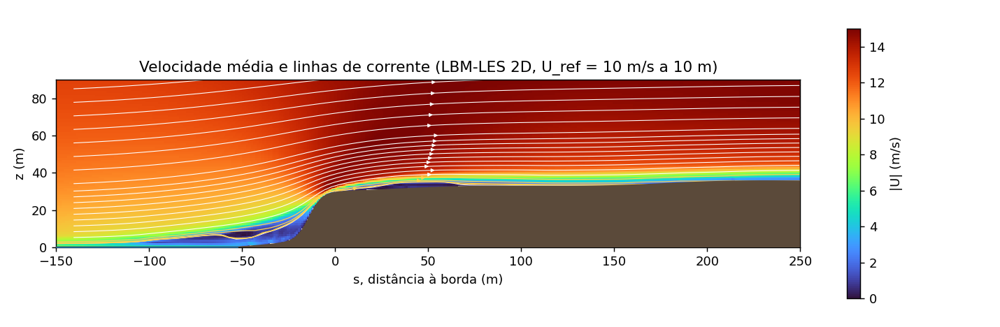
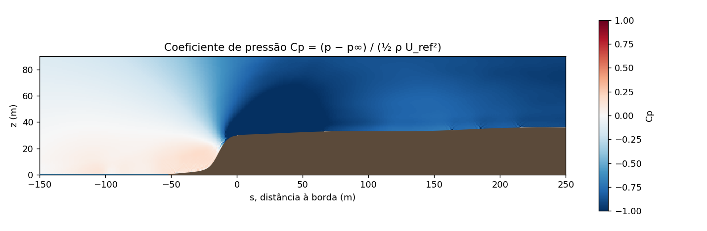
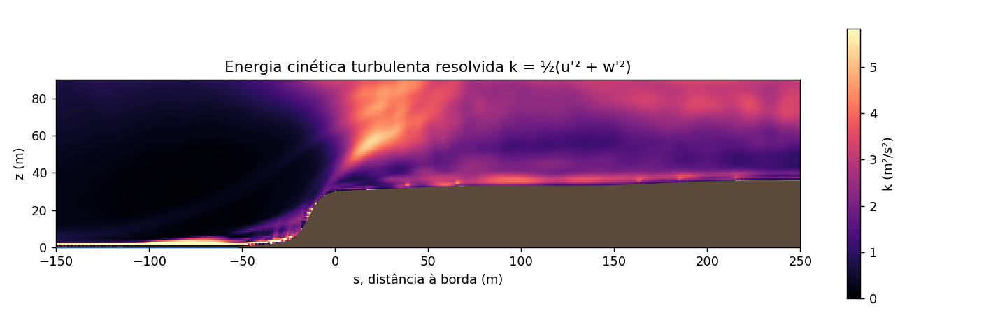
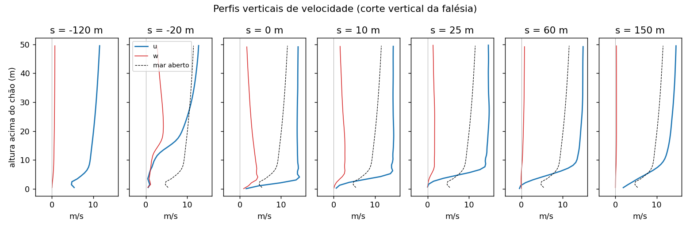
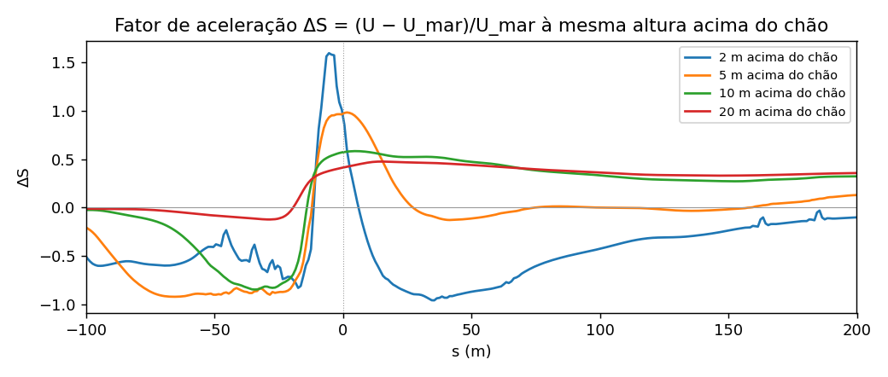

Leitura física:
- **Estagnação na face:** Cp > 0 no pé e na face da falésia, onde o ar desacelera ao bater no paredão.
- **Aceleração no topo:** as linhas de corrente se comprimem sobre a borda (continuidade). A 10 m do chão isso dá U/U_mar ≈ 1,6, perto do que o Eurocode 1 prevê para esta falésia (seção 7, V5).
- **Separação:** a borda é uma quina, então o escoamento descola e forma uma **camada cisalhante** (máximo de k). Abaixo dela, junto ao chão, o vento médio é fraco e chega a inverter (u < 0). A existência dessa zona é robusta; o comprimento dela não (seção 7).
- **Na estrada** (s ≈ 5,6 m), a 1,6 m do chão o vento médio é de apenas 3 a 5 m/s, mas a 5 m de altura já passa de 12 m/s. As rajadas que chegam ao chão vêm dessa camada cisalhante, e por isso a grama "pulsa".

### 7. Verificação e validação

**Verificação** pergunta se as equações foram resolvidas corretamente. **Validação** pergunta se o resultado concorda com a realidade ou com uma referência independente. Os scripts estão em [cfd/verificacao_poiseuille.py](cfd/verificacao_poiseuille.py) e [cfd/verificacao_falesia.py](cfd/verificacao_falesia.py), e os números ficam em `cfd/verificacao/`.

**V1. Solução analítica (Poiseuille).** Escoamento laminar entre placas, rodado com **o mesmo kernel** do solver da falésia, com o Smagorinsky e o modelo de parede desligados:

| teste | resultado |
| --- | --- |
| perfil de velocidade × parábola exata (h = 22 células) | erro RMS de **0,08 %** de u_max |
| gradiente de pressão × −12 μŪ/h² | erro de 12,1 % → 3,5 % → 1,0 % com h = 11, 22, 44 células |
| ordem de convergência observada | **1,8** (o LBM com bounce-back é de 2ª ordem) |
| vazão ao longo do canal | constante a 5·10⁻¹³ |

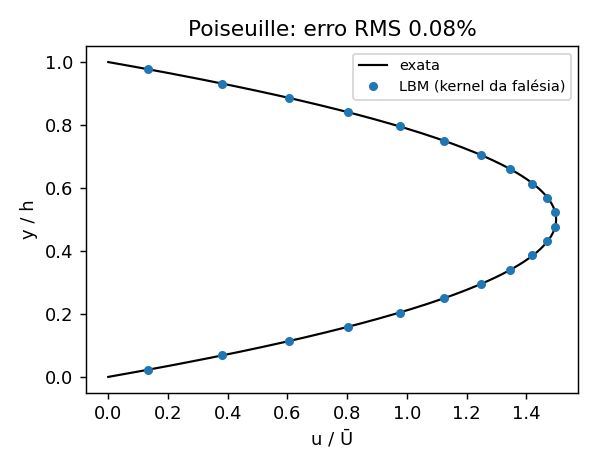

**V2. Convergência de malha.** Três malhas (Δx = 2, 1 e 0,5 m, razão de refino 2), com o índice de convergência de malha (GCI) de Roache:

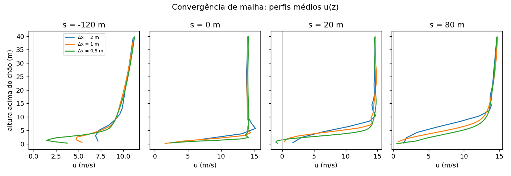

- **Acima de ~5 m do chão** as três malhas coincidem. A velocidade sobre o mar converge com ordem 2,1 (GCI 0,1 %), o Cp mínimo com ordem 1,3 (GCI 6,6 %), e ΔS a 10 e 20 m oscila dentro de ±5–7 %.
- **Abaixo de ~5 m** as malhas não concordam: ΔS a 5 m e o tamanho da bolha ainda mudam com o refino. É a região governada pelo modelo de parede e pela separação, as partes mais difíceis de um LES em grade uniforme. Em LES a malha também muda o filtro do Smagorinsky (Δ = Δx), então não se espera convergência "clássica" ali.

**V3. Convergência estatística.** As médias da 1ª e da 2ª metade de uma janela de 192 s (malha de 1 m) diferem **menos de 1 %** em todas as métricas: a janela de média é suficiente.

**V4. Conservação de massa.** A vazão média ao longo do domínio varia no máximo **0,07 %** (malha de 1 m), 0,18 % (2 m) e 0,32 % (0,5 m, janela de média mais curta).

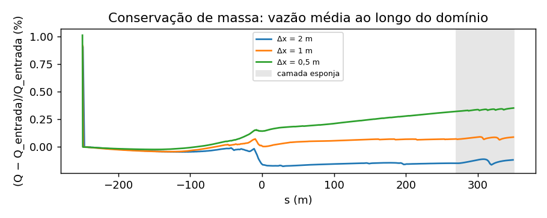

**V5. Validação: Eurocode 1 (EN 1991-1-4:2005, Anexo A.3).** A norma europeia de vento dá o coeficiente orográfico `c_o = U_local / U_terreno plano` para falésias e escarpas, uma fórmula empírica de projeto. Para esta falésia: H = 30 m, Lu = 31 m (extensão da face entre 5 % e 95 % de H), Φ = H/Lu = 0,96 > 0,3, logo `c_o = 1 + 0,6 s`, com Le = H/0,3 = 100 m e `s` pelas expressões A.4–A.10.

| altura acima do chão | Eurocode (pico) | CFD 0,5 m (pico) | diferença |
| --- | --- | --- | --- |
| 20 m | 1,44 | 1,45 | **+0,6 %** |
| 10 m | 1,51 | 1,61 | **+6 %** |
| 5 m | 1,51 | 1,84 | +21 % |

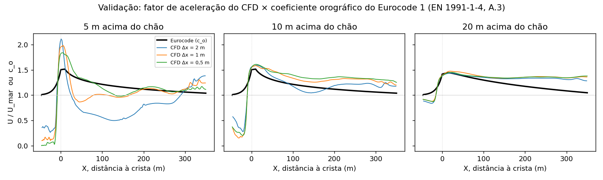

- No **pico de aceleração da crista, a 10 e 20 m**, o CFD reproduz a norma.
- **A 5 m**, logo atrás da quina, o CFD acelera mais e depois cai por causa da separação. O Eurocode é uma regra para escoamento colado e não modela a bolha. Além disso, esse é o valor que não convergiu na malha (V2).
- **Antes da falésia** o CFD mostra a desaceleração da zona de estagnação, que a norma ignora (ela nunca reduz o vento abaixo de 1).
- **Muito a jusante (X > 150 m)** o CFD fica até ~25 % acima da norma, por dois motivos: o bloqueio residual do domínio e a referência U_mar, medida a 4 H da borda, onde a falésia já freia um pouco o escoamento.

**Problemas encontrados e corrigidos durante o desenvolvimento** (antes destes testes):
1. **Camada-limite grossa demais** (não-deslizamento numa grade de 1 m), corrigida com o modelo de parede da seção 4.
2. **Aceleração artificial de todo o escoamento a jusante:** o domínio de 150 m bloqueava 20 % da seção. Corrigida subindo o topo para 240 m (12,5 %).
3. **Pressão em xadrez** (modos fantasmas do BGK com τ ≈ 0,5), corrigida com a colisão regularizada e a saída com pressão fixa.

**O que dá para afirmar:** o solver resolve Navier–Stokes corretamente (V1, V4), a média estatística está convergida (V3), e a aceleração do vento no topo, a partir de ~10 m do chão, é praticamente independente da malha (V2) e concorda com o Eurocode 1 dentro de 6 % (V5). **O que não dá para afirmar:** valores quantitativos junto ao chão (< 5 m), como o tamanho da bolha de recirculação.

### 8. Limitações

- **2D.** Turbulência 2D não é 3D: em 2D a energia sobe para escalas maiores (cascata inversa), então os vórtices são mais coerentes e "redondos" que na realidade. O campo médio acima de ~5 m é uma boa aproximação para uma falésia longa; as flutuações são qualitativas.
- **Junto ao chão (< 5 m):** sem convergência de malha (V2). A cena usa a malha de 1 m e, abaixo de 1,5 m, a lei log `u(z) = u(z_ref) ln(z/z₀)/ln(z_ref/z₀)` para a grama.
- **Bloqueio residual de 12,5 %:** acelera o escoamento livre a jusante (V5, X > 150 m).
- **Validação por norma, não por medição:** o Eurocode é uma referência independente, baseada em dados, mas não é um experimento desta geometria. Comparar com medições de túnel de vento ou de campo seria o próximo passo.
- **Do 2D para o 3D:** cada ponto da cena usa o corte local perpendicular à costa. A componente paralela à costa segue o **princípio da independência** (válido para cristas longas). A descorrelação lateral das rajadas é sintética (hipótese de Taylor com defasagem que varia ao longo da costa).


---

## Como o vento move a cena

| elemento | modelo | arquivo |
| --- | --- | --- |
| **grama e flores** | cada folha se curva num arco de comprimento constante, com ângulo `θ = θmax(1 − e^(−c U²))` (arrasto ∝ U²) + flutter ∝ U; o vento é amostrado na GPU numa textura 3D (s, z, tempo) com interpolação temporal entre quadros do CFD | [src/grama.js](src/grama.js) |
| **nuvens** | cúmulos volumétricos (raymarching, Beer–Lambert + powder + Henyey–Greenstein); a deriva usa o perfil de entrada extrapolado até 1,5 km: `U = 10 (1500/10)^0,11 ≈ 17 m/s` | [src/ceu.js](src/ceu.js) |
| **mar** | ondas de Gerstner, espuma pelo jacobiano e reflexo do céu (**Projeto 24**), mais profundidade a partir do perfil da falésia: as ondas diminuem no raso, a água fica turquesa sobre a areia e há arrebentação | [src/oceano.js](src/oceano.js) |

## Modo científico ([src/cientifico.js](src/cientifico.js))

- **Plano de corte** com mapa de cor de |U|, u, w (campo instantâneo) ou Cp, k (média) e isolinhas. O terreno é recortado no plano (clipping), e a seção do solo aparece como uma "tampa" com estratos.
- **Linhas de corrente** do campo médio (Runge–Kutta 2), com sementes extras dentro da bolha para mostrar o laço fechado.
- **Vetores** e **partículas traçadoras** advectadas no campo instantâneo: mostram as rajadas e a recirculação ao vivo.
- **Painel:** perfis u(z) acima do chão no mar, na borda, na bolha e no planalto (média e instantâneo), mais os números-chave calculados no navegador a partir dos dados.
- A grama é colorida pela velocidade local.

## Modelos (Blender 4.5, por script)

[blender/gerar_modelos.py](blender/gerar_modelos.py):
- `bicicleta.glb`: bicicleta urbana com quadro de aço pintado (clearcoat), aros cromados, 32 raios cruzados por roda, paralamas, selim e manoplas de couro, bagageiro com bolsa de lona e descanso lateral (na cena ela fica estacionada, inclinada ~7°).

## Estrutura

```
cfd/            geometria.py · lbm_falesia.py (solver) · figuras.py
blender/        gerar_modelos.py
public/dados/   perfil.json · vento.json · campo_medio.bin (média) · rajadas.bin (instantâneos)
public/models/  bicicleta.glb
src/            main.js · geometria.js · vento.js · grama.js · terreno.js
                oceano.js + ondas.js (Projeto 24) · ceu.js · cientifico.js
docs/           figuras/ (CFD) · capturas/ (cena)
```

## Referências

- Krüger, T. et al. *The Lattice Boltzmann Method: Principles and Practice*. Springer, 2017.
- Latt, J.; Chopard, B. Lattice Boltzmann method with regularized pre-collision distribution functions. *Math. Comput. Simul.* 72, 2006.
- Hou, S. et al. A lattice Boltzmann subgrid model for high Reynolds number flows. *Fields Inst. Commun.* 6, 1996.
- CEN. *EN 1991-1-4:2005 Eurocode 1: Actions on structures — Part 1-4: General actions — Wind actions*, Anexo A.3 (coeficiente orográfico).
- Roache, P. J. Perspective: a method for uniform reporting of grid refinement studies. *J. Fluids Eng.* 116, 1994 (GCI).
- Stull, R. *An Introduction to Boundary Layer Meteorology*. Kluwer, 1988 (lei log, z₀).
- Mikhailov, A. *Turbo, an improved rainbow colormap*. Google AI Blog, 2019.
